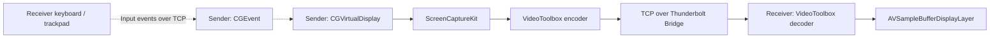

<!-- README_SYNC: source=working-tree; updated=2026-10-24 -->

简体中文 · [English](./README_EN.md)

# AirDisplay

**把另一台 Mac 变成有线扩展屏，同时保留 iPad 随航。**

有同样的双 Mac 需求，可以 [点个 Star 收藏](https://github.com/Shaojie66/AirDisplay)，方便以后回来。

[](https://github.com/Shaojie66/AirDisplay)
[](./project.yml)
[](./project.yml)
[](#status)

主力 Mac 运行应用，另一台 Mac 只负责显示。窗口可以从主屏拖到副 Mac，文件和应用仍留在主力 Mac 上；接上 iPad 随航后，就是三屏工作区。

这个项目源于一次实际限制：在作者的设备上，AirPlay to Mac 一连上，iPad 随航就会断开。AirDisplay 通过虚拟显示器和雷雳网桥传画面，已在 MacBook Pro + MacBook Air + iPad 上验证三屏共存。见 [跨机实测](./docs/M3-cross-machine.md)。

- **扩展桌面**：主力 Mac 创建独立虚拟屏，副 Mac 全屏显示这块屏幕。
- **文字与画质**：默认 2880×1864 像素、1440×932 点 HiDPI、60 Hz；可选 4:4:4 色度，改善彩色小字，代价是更高码率和延迟。
- **连接自动管理**：接收端连上后自动建屏、推流；断开约 3 秒后移除虚拟屏，让窗口回到主屏；恢复连接后自动重建。
- **副机键鼠可用**：可用副 Mac 的键盘和触控板操作虚拟屏内的应用，需在主力 Mac 授予辅助功能权限。

想直接试用，跳到 [快速开始](#quick-start)。

> 实验性项目，使用未公开的 `CGVirtualDisplay` API，不面向 App Store 发布。macOS 更新可能影响可用性；目前需自行构建和签名。

<a id="quick-start"></a>

## 快速开始

### 准备

- 两台 Apple 芯片 Mac，以及一根支持雷雳网桥的雷雳 / USB4 线；仅能充电的 USB-C 线不够。
- 构建机安装 Xcode、[XcodeGen](https://github.com/yonaskolb/XcodeGen)，并在 Xcode 中准备好 Apple Development 签名证书。
- [工程部署目标](./project.yml) 为 macOS 14.0；这不代表已在所有后续系统版本上实测。当前验证组合为 M4 Max MacBook Pro → 15 英寸 M3 MacBook Air，发送端系统和工具版本见 [环境记录](./docs/M0-environment.md)。
- 使用可信的直连环境：当前传输使用 TCP，未启用 TLS 或配对认证；默认 Receiver 只连接 `bridge0` 上发现的服务，不提供常规 Wi-Fi 连接模式。

### 1. 获取源码并配置签名

已有仓库可跳过克隆；以下构建命令都在仓库根目录执行。

```sh
git clone https://github.com/Shaojie66/AirDisplay.git
cd AirDisplay
cp -n Config/Local.xcconfig.example Config/Local.xcconfig
```

在本机编辑 `Config/Local.xcconfig`，把 `YOUR_TEAM_ID` 换成自己的 Team ID。该文件已被忽略，不要提交证书或个人签名信息；`cp -n` 会保留已有配置。

### 2. 构建两个 App

```sh
xcodegen generate
xcodebuild -project AirDisplay.xcodeproj -scheme Sender -configuration Release -derivedDataPath build build
xcodebuild -project AirDisplay.xcodeproj -scheme Receiver -configuration Release -derivedDataPath build build
```

构建产物位于 `build/Build/Products/Release/`：

| App | 放在哪台 Mac | 用途 |
| --- | --- | --- |
| `AirDisplaySender.app` | 主力 Mac 的「应用程序」 | 创建虚拟屏、抓屏、编码和发送 |
| `AirDisplayReceiver.app` | 副 Mac 的「应用程序」 | 接收画面、解码、全屏显示和转发键鼠 |

Receiver 可通过隔空投送拷到副 Mac。更新 App 时先退出旧版，再覆盖；Sender 保持安装在 `/Applications/AirDisplaySender.app`，避免登录项和权限因位置变化受到影响。

### 3. 首次打开并授权

分别打开两台 Mac 上的 App。若系统拦截你自行构建的 App，在「系统设置 → 隐私与安全性」中检查提示，选择「仍要打开」。

| 权限 | 授予位置 | 何时需要 |
| --- | --- | --- |
| 屏幕录制 / 屏幕与系统音频录制 | 主力 Mac → 隐私与安全性 → AirDisplay Sender | 抓取虚拟屏画面；授权后重新打开 Sender |
| 本地网络 | 两台 Mac 的系统提示或隐私与安全性设置 | 发现与连接对方 |
| 辅助功能 | 主力 Mac → 隐私与安全性 → AirDisplay Sender | 想用副 Mac 的键盘和触控板时 |

### 4. 连接并拖入一个窗口

用线连接两台 Mac，确认「系统设置 → 网络」中的雷雳网桥已建立。Sender 启动后先等待连接；Receiver 自动发现对方，连上后进入全屏，Sender 同时创建名为 **AirDisplay** 的虚拟屏。

在主力 Mac 的「系统设置 → 显示器」里调整 AirDisplay 的排列，把一个窗口拖过去。**副 Mac 能显示并操作这个窗口，就是首次连接成功。** 需要三屏时再连接 iPad 随航。

<a id="usage"></a>

## 日常使用

| 操作 | 入口或行为 |
| --- | --- |
| 查看帧率、码率、解码与管线延迟 | Receiver 按 `⌃⌥⌘S`，即 Control + Option + Command + S |
| 退出 Receiver | `⌃⌥⌘Q` |
| 改善彩色代码小字 | Sender 控制面板勾选「4:4:4 色度」；默认关闭，接收端不支持时回退 4:2:0 |
| 关闭副机键鼠转发 | Sender 控制面板或 Receiver App 菜单；两端开关默认均开启 |
| 登录时自动打开 | Sender 控制面板、Receiver App 菜单分别设置；默认关闭 |
| 拔线或退出 Receiver | 默认约 3 秒后移除虚拟屏，Receiver 退回普通窗口；连回后自动恢复 |

Receiver 等待连接时会保留普通窗口，便于看见系统权限提示。需要修改 Receiver 菜单设置时，可先断开线缆，等待退回普通窗口；重新连接后自动恢复全屏。

## 实测表现

以下为 **2026-10-24** 的开发记录，测试组合是 M4 Max MacBook Pro → M3 MacBook Air，经雷雳网桥传输，画面为 2880×1864、默认 4:2:0，并包含一个持续刷新的时钟。它们是这组设备的观测值。

| 指标 | 记录值 | 测量范围 |
| --- | --- | --- |
| 接收帧率 | 约 58 fps | Receiver 浮层读数；静止画面不会持续产生新帧 |
| 实际码率 | 25.9 Mbps | 当时测试画面，随内容变化 |
| 解码耗时 | 2.6 ms | Receiver 解码阶段 |
| 抓屏 → 解码完成 | 14.6 ms，最大 16.0 ms | 两机 ping/pong 估算时钟差后的管线读数，不含接收端屏幕合成和刷新 |
| 两屏可见时钟差 | 约 50 ms | 单张手机照片，包含显示环节；估计误差约 ±16 ms |

数据来源：[跨机显示](./docs/M3-cross-machine.md)、[画质与拍照测量](./docs/M4-polish.md)。**14.6 ms 不能当作完整的屏幕显示延迟；拍照记录约 50 ms，尚未达到 ≤33 ms 的目标。**

4:4:4 在本机回环对比中改善了彩色小字，但编码、解码和带宽成本都更高；M3 接收端已验证可用。它默认关闭，完整实验条件见 [M4 记录](./docs/M4-polish.md)。

## 工作原理



Bonjour 负责发现服务；Receiver 将连接绑定到 `bridge0`，避免同网段路由把流量带到 Wi-Fi。视频通过硬件编解码，积压时丢帧并请求关键帧，减少排队。输入事件沿同一连接返回 Sender，再由 `CGEvent` 注入。

源码入口：[Sender](./Sender/Sources/)、[Receiver](./Receiver/Sources/)、[共享协议与显示模块](./Shared/)。编码器取舍与本机回环数据见 [M2 报告](./docs/M2-loopback.md)。

<a id="status"></a>

## 当前状态与限制

虚拟屏、随航共存、跨机显示、断线重连和基础键鼠转发已有验证记录。项目仍是针对当前设备组合验证的实验实现。

- **分辨率目前固定**：默认针对 15 英寸 MacBook Air；没有任意机型、自适应分辨率的验证。接收端系统缩放可能引入二次缩放，影响清晰度。
- **输入转发有范围**：`⌘Tab`、`⌘Space` 等系统快捷键会先被副 Mac 处理；缩放、旋转和三指手势不转发。副机触控板只能在 AirDisplay 区域内操作，不能跨到主机其他屏幕。见 [输入转发记录](./docs/M5-input.md)。
- **单接收端**：同一时间只服务一个 Receiver，新连接会替换旧连接。
- **无音频传输**：当前只传画面和键鼠事件。
- **延迟仍有优化空间**：Metal 直接呈现已讨论，但当前暂缓，尚未实现。
- **私有 API 兼容性有限**：系统升级后需重新验证，不保证所有 Mac 或 macOS 版本可用。

### 连不上时先检查

1. **Receiver 一直搜索**：确认雷雳网桥已建立、线材支持，并已允许两端的本地网络访问；仅同一 Wi-Fi 不够。
2. **连接后没有画面**：检查 Sender 的屏幕录制权限，授权后退出并重新打开。
3. **画面正常，键鼠无效**：检查两端的转发开关，以及 Sender 的辅助功能权限。
4. **画面文字偏软**：核对主机虚拟屏的 HiDPI 模式和副机缩放设置；彩色小字可尝试 4:4:4，并观察延迟变化。

更多开发证据：[M0 环境](./docs/M0-environment.md) · [M1 虚拟屏与随航](./docs/M1-virtual-display.md) · [M2 本机回环](./docs/M2-loopback.md) · [M3 跨机](./docs/M3-cross-machine.md) · [M4 画质与重连](./docs/M4-polish.md) · [M5 键鼠](./docs/M5-input.md)。

## 许可与致谢

当前仓库未附 `LICENSE` 文件，尚未声明使用、修改与再分发的许可证。

虚拟显示器的私有 API 声明参考了 [DeskPad](https://github.com/Stengo/DeskPad)。

如果 AirDisplay 帮你用上了另一台 Mac 的屏幕，欢迎 [Star 收藏](https://github.com/Shaojie66/AirDisplay)。复现问题或有改进建议，可提交 [Issue](https://github.com/Shaojie66/AirDisplay/issues)，附上机型、系统版本、现象和脱敏后的统计信息。
