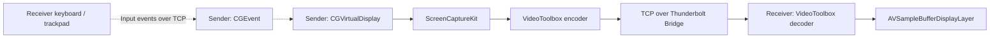

<!-- README_SYNC: source=working-tree; updated=2026-10-24 -->

[简体中文](./README.md) · English

# AirDisplay

**Use another Mac as a wired extended display while keeping your iPad connected through Sidecar.**

Have a similar dual-Mac setup? [Star the repository](https://github.com/Shaojie66/AirDisplay) to find it again later.

[](https://github.com/Shaojie66/AirDisplay)
[](./project.yml)
[](./project.yml)
[](#status)
[](./LICENSE)

Your main Mac runs the applications. The second Mac displays an extended desktop, so you can drag windows onto it while keeping applications and files on the main machine. Add an iPad through Sidecar for a three-screen workspace.

The project started with a problem on the author's devices: connecting AirPlay to Mac disconnected the iPad's Sidecar session. AirDisplay uses a virtual display and Thunderbolt Bridge instead. A MacBook Pro + MacBook Air + iPad setup has been verified in the [cross-machine test](./docs/M3-cross-machine.md).

- **An extended desktop**: Sender creates a separate virtual display; Receiver shows it full screen on the second Mac.
- **Text clarity controls**: 2880×1864 pixels at 1440×932 HiDPI points, 60 Hz. Optional 4:4:4 chroma improves small colored text at the cost of bandwidth and latency.
- **Connection-driven display management**: connecting creates the display and starts streaming. After roughly 3 seconds disconnected, the display is removed and windows return to the main screen. Reconnecting restores it automatically.
- **Input from the second Mac**: use its keyboard and trackpad within the virtual display after granting Accessibility permission on the main Mac.

Ready to try it? Go to [Quick start](#quick-start).

> Experimental software using the private `CGVirtualDisplay` API. This project is not intended for App Store distribution. macOS updates may break it; building and signing from source are currently required.

<a id="quick-start"></a>

## Quick start

### Requirements

- Two Apple silicon Macs and a Thunderbolt / USB4 cable that supports Thunderbolt Bridge. A charge-only USB-C cable will not work.
- Xcode, [XcodeGen](https://github.com/yonaskolb/XcodeGen), and an Apple Development signing certificate configured in Xcode on the build machine.
- The [deployment target](./project.yml) is macOS 14.0. This is a build setting, not a claim that every subsequent macOS version has been tested. The verified hardware is an M4 Max MacBook Pro sending to a 15-inch M3 MacBook Air; see the [environment report](./docs/M0-environment.md) for Sender's OS and tool versions.
- A trusted direct connection. The current TCP transport has no TLS or pairing authentication. By default, Receiver only connects to services discovered on `bridge0`; there is no regular Wi-Fi connection mode.

### 1. Get the source and configure signing

Skip cloning if you already have the repository. Run all build commands from its root.

```sh
git clone https://github.com/Shaojie66/AirDisplay.git
cd AirDisplay
cp -n Config/Local.xcconfig.example Config/Local.xcconfig
```

Edit `Config/Local.xcconfig` locally and replace `YOUR_TEAM_ID` with your own Team ID. This file is ignored by Git. Keep certificates and personal signing details out of commits; `cp -n` preserves an existing configuration.

### 2. Build both applications

```sh
xcodegen generate
xcodebuild -project AirDisplay.xcodeproj -scheme Sender -configuration Release -derivedDataPath build build
xcodebuild -project AirDisplay.xcodeproj -scheme Receiver -configuration Release -derivedDataPath build build
```

Build products are written to `build/Build/Products/Release/`:

| Application | Install on | Role |
| --- | --- | --- |
| `AirDisplaySender.app` | Applications on the main Mac | Create the virtual display, capture, encode, and send video |
| `AirDisplayReceiver.app` | Applications on the second Mac | Receive, decode, display full screen, and forward input |

AirDrop is one way to transfer Receiver to the second Mac. Quit the old application before replacing it. Keep Sender at `/Applications/AirDisplaySender.app` so moving it does not interfere with login items and permissions.

### 3. Launch and grant permissions

Open the appropriate application on each Mac. If macOS blocks an application you built, review the message in System Settings → Privacy & Security and choose Open Anyway.

| Permission | Grant on | Needed for |
| --- | --- | --- |
| Screen Recording / Screen & System Audio Recording | Main Mac → Privacy & Security → AirDisplay Sender | Capturing the virtual display; reopen Sender after granting access |
| Local Network | System prompt or Privacy & Security on both Macs | Discovering and connecting to the other machine |
| Accessibility | Main Mac → Privacy & Security → AirDisplay Sender | Using the second Mac's keyboard and trackpad |

### 4. Connect and move a window

Connect the Macs with the cable and confirm Thunderbolt Bridge is established in System Settings → Network. Sender initially waits for a connection. Receiver discovers it automatically, switches to full screen when connected, and Sender creates a virtual display named **AirDisplay**.

Arrange AirDisplay in System Settings → Displays on the main Mac, then drag a window onto it. **Seeing and interacting with that window on the second Mac confirms the first connection.** Connect your iPad through Sidecar when you want the third screen.

<a id="usage"></a>

## Everyday use

| Action | Control or behavior |
| --- | --- |
| View frame rate, bitrate, decoding time, and pipeline latency | Press `⌃⌥⌘S` in Receiver: Control + Option + Command + S |
| Quit Receiver | `⌃⌥⌘Q` |
| Improve small colored code text | Enable 4:4:4 chroma in Sender's control panel; off by default, with a 4:2:0 fallback if Receiver lacks support |
| Disable forwarded keyboard and trackpad input | Sender's control panel or Receiver's application menu; both switches are on by default |
| Launch at login | Configure each app separately in Sender's control panel or Receiver's application menu; off by default |
| Unplug or quit Receiver | After roughly 3 seconds, the virtual display is removed and Receiver returns to a normal window; reconnecting restores the session |

Receiver uses a normal window while waiting to connect so system permission prompts remain visible. To change settings in its menu, disconnect the cable and wait for the normal window to return. Reconnecting restores full screen automatically.

## Measured performance

These observations come from development records dated **2026-10-24**: M4 Max MacBook Pro → M3 MacBook Air over Thunderbolt Bridge, 2880×1864 video with default 4:2:0 chroma and a continuously updating clock. They describe that setup.

| Metric | Recorded value | Measurement scope |
| --- | --- | --- |
| Received frame rate | About 58 fps | Receiver overlay; static content does not continuously produce new frames |
| Actual bitrate | 25.9 Mbps | The test scene at that moment; varies with content |
| Decode time | 2.6 ms | Receiver's decoding stage |
| Capture callback → decode completion | 14.6 ms, maximum 16.0 ms | Pipeline estimate using ping/pong clock-offset correction; excludes Receiver's display compositing and refresh |
| Visible clock difference between screens | About 50 ms | One phone photograph, including presentation; estimated uncertainty of ±16 ms |

Sources: [cross-machine results](./docs/M3-cross-machine.md) and [image quality and photographic measurement](./docs/M4-polish.md). **14.6 ms is not full display latency. The photographic result was about 50 ms, short of the ≤33 ms target.**

Local loopback comparisons showed clearer small colored text with 4:4:4, at higher encoding, decoding, and bandwidth costs. The M3 Receiver has also been verified to handle it. It remains off by default; see [M4](./docs/M4-polish.md) for the experiment conditions.

## How it works



Bonjour discovers the service. Receiver binds its connection to `bridge0` so overlapping network routes do not send traffic through Wi-Fi. Video uses hardware encoding and decoding; when sending backs up, Sender drops frames and requests a keyframe to limit queueing. Input events travel back on the same connection and are injected by Sender using `CGEvent`.

Source entry points: [Sender](./Sender/Sources/), [Receiver](./Receiver/Sources/), and [shared protocol and display code](./Shared/). See [M2](./docs/M2-loopback.md) for encoder tradeoffs and local loopback results.

<a id="status"></a>

## Status and limitations

Development records cover virtual display creation, Sidecar coexistence, cross-machine video, reconnection, and basic input forwarding. This is still an experimental implementation verified on the current hardware combination.

- **Fixed display configuration**: the default targets a 15-inch MacBook Air. Arbitrary models and adaptive resolutions have not been validated. Receiver's system scaling can add another scaling pass and affect clarity.
- **Input forwarding has limits**: shortcuts such as `⌘Tab` and `⌘Space` are handled by the second Mac first. Pinch, rotation, and three-finger gestures are not forwarded. Its trackpad controls the AirDisplay area only, not the main Mac's other screens. See [input forwarding](./docs/M5-input.md).
- **One Receiver at a time**: a new connection replaces the previous Receiver.
- **No audio streaming**: the current implementation sends video and input events only.
- **Presentation latency can still improve**: direct Metal presentation was discussed and deferred; it is not implemented.
- **Private API compatibility**: OS upgrades require another verification pass. Support is not guaranteed across all Mac models or macOS versions.

### Troubleshooting

1. **Receiver keeps searching**: confirm Thunderbolt Bridge is established, the cable supports it, and both applications have Local Network permission. Sharing a Wi-Fi network is insufficient.
2. **Connected but no video**: check Sender's Screen Recording permission, then quit and reopen it after granting access.
3. **Video works but input does not**: check both input-forwarding switches and Sender's Accessibility permission.
4. **Text looks soft**: check the virtual display's HiDPI mode and Receiver's system scaling. For small colored text, try 4:4:4 and watch the latency tradeoff.

Development records, in Chinese: [M0 environment](./docs/M0-environment.md) · [M1 virtual display and Sidecar](./docs/M1-virtual-display.md) · [M2 loopback](./docs/M2-loopback.md) · [M3 cross-machine](./docs/M3-cross-machine.md) · [M4 quality and reconnection](./docs/M4-polish.md) · [M5 input](./docs/M5-input.md).

## License and acknowledgements

This project is open source under the [MIT License](./LICENSE). Use, modification, distribution, and commercial use are permitted with the copyright and permission notices retained.

The private virtual-display API declarations were informed by [DeskPad](https://github.com/Stengo/DeskPad). Its copyright and license notice are preserved in [third-party notices](./THIRD_PARTY_NOTICES.md).

If AirDisplay helps you put another Mac's screen to use, [give it a Star](https://github.com/Shaojie66/AirDisplay). For problems or suggestions, open an [Issue](https://github.com/Shaojie66/AirDisplay/issues) with the hardware, OS version, observed behavior, and sanitized statistics.
